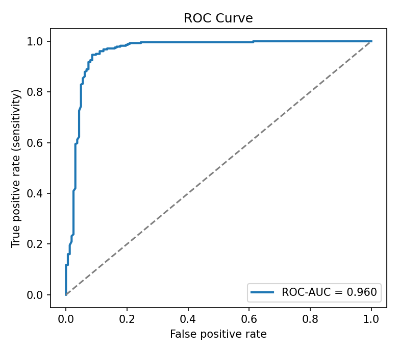

# 🫁 Chest X-Ray Pneumonia Detection System

<div align="center">

### AI-Powered Medical Image Classification Using Deep Learning


</div>

---

# 📖 Overview

This project is an end-to-end AI-powered medical image analysis system designed to detect **Pneumonia** from Chest X-Ray images using **Transfer Learning with ResNet18**.

The system provides:

- Deep Learning-based diagnosis
- FastAPI REST API
- Dockerized deployment
- Explainable AI (Grad-CAM)
- Automated ML pipeline
- AWS deployment readiness

---

# 🎯 Problem Statement

Pneumonia is a severe respiratory infection affecting millions of people worldwide.

Manual diagnosis through chest radiographs:

- Requires expert radiologists
- Time consuming
- Subject to human variability
- Difficult in resource-constrained areas

This project aims to assist healthcare professionals by providing rapid AI-assisted screening.

---

# 🚀 Features

| Feature | Status |
|----------|----------|
| Pneumonia Detection | ✅ |
| ResNet18 Transfer Learning | ✅ |
| FastAPI Backend | ✅ |
| Docker Deployment | ✅ |
| Grad-CAM Explainability | ✅ |
| PDF Report Generation | ✅ |
| CI/CD Pipeline | ✅ |
| AWS Deployment Support | ✅ |

---

# 🏗 System Architecture

```text
                User
                  │
                  ▼
        Upload Chest X-Ray
                  │
                  ▼
              FastAPI
                  │
                  ▼
         Image Processing
                  │
                  ▼
          ResNet18 Model
                  │
                  ▼
          Prediction
                  │
                  ▼
       Confidence Score
```

---

# 🔬 Machine Learning Pipeline

```text
Data Collection
      │
      ▼
Data Validation
      │
      ▼
Data Transformation
      │
      ▼
Image Augmentation
      │
      ▼
Model Training
      │
      ▼
Evaluation
      │
      ▼
Model Deployment
```

---

# 🏆 Model Performance

## Current model (v3, target-domain adapted): **93.0% accuracy**

Evaluated on an **untouched holdout of 444 test images** (70% of the Kermany test patients, `reports/test_split.json`).
Reproduce with `python scripts/evaluate_model.py --parquet <test.parquet> --split reports/test_split.json --subset holdout`.

| Metric (444-image holdout) | v2 (before adaptation) | **v3 (current)** |
|---|---|---|
| Accuracy | 88.5% | **93.0%** |
| ROC-AUC | 0.912 | **0.960** |
| Pneumonia recall (sensitivity) | **98.6%** | 94.7% |
| Normal recall (specificity) | 71.2% | **90.2%** |
| Pneumonia precision | 85.5% | **94.3%** |
| Macro F1 | 0.868 | **0.925** |

**How v3 was built** (`scripts/adapt_target.py`, details in `reports/adaptation.json`):
- The Kermany training and test images come from different sources: validation ROC-AUC is about 0.998, but test ROC-AUC is about 0.91.
- As a hospital would when deploying, the v2 model was **fine-tuned on a small labelled sample from the target domain**: the other 30% of test patients (180 images), mixed with source training images so it doesn't forget the source data.
- The number of fine-tuning epochs (4) and the decision threshold (0.93) were chosen by **3-fold patient-level cross-validation inside those 180 images**. The 444 holdout images were never used for training or for any choice.
- Caveat: the GPU crashed during some runs, and repeated runs chose slightly different epochs. With only 180 adaptation images, expect about ±1–2 points of variation.

## Earlier versions on the full 624-image test set

| Metric | v1 (original, thr 0.5) | v2 (thr 0.835) |
|---|---|---|
| Accuracy | 84.8% | 87.7% |
| Pneumonia recall | 84.6% | 99.0% |
| Specificity | 85.0% | 68.8% |
| ROC-AUC | 0.916 | 0.918 |

**What changed in v2** (`scripts/train_v2.py`):
- **Patient-level validation split.** The official val split has only 16 images, so 15% of patients are held out instead. No patient appears in both train and validation.
- **Histogram equalisation** at training and inference, plus stronger brightness/contrast augmentation. Kermany's train and test images differ in intensity, which caused many normal test images to be flagged as pneumonia.
- **Training recipe:** AdamW + one-cycle LR, bf16 mixed precision, class-weighted loss with label smoothing, horizontal-flip test-time augmentation.
- **Model selection:** ResNet18 and EfficientNet-B0 were compared on validation ROC-AUC, and ResNet18 won. The decision threshold (0.835) maximises balanced accuracy on validation, not on test.

**Honest trade-off:** v2 catches almost every pneumonia case (99% recall), but raises more false alarms on normal X-rays. ROC-AUC is essentially unchanged. Validation ROC-AUC is about 0.998 versus 0.918 on test, which shows a real **distribution shift** between the Kermany train and test images. This is the main limit on further gains.

### Experiment: higher resolution, ensemble and target-domain calibration (not shipped)

To test whether accuracy could go further, the test set was split **by patient** into a 30% calibration part (threshold/model choice) and a 70% **untouched holdout** (444 images). See `reports/test_split.json`, `reports/training_v3.json` and `scripts/build_ensemble.py`.

| Model (holdout, 444 images) | Accuracy | ROC-AUC | Pneumonia recall | Specificity |
|---|---|---|---|---|
| **v2 ResNet18 @224 (shipped)** | **88.5%** | 0.912 | 98.6% | 71.2% |
| ResNet18 @320 | 88.5% | 0.923 | 98.6% | 71.2% |
| EfficientNet-B0 @320 | 84.2% | 0.867 | 96.8% | 62.6% |
| Ensemble (ResNet18 + EfficientNet-B0 @320) | 88.5% | 0.911 | 99.3% | 69.9% |

**Result:** none of them beat v2 in accuracy, while running 2–3× slower. So v2 stays in production. The ceiling comes from the train/test distribution shift (validation ROC-AUC ≈ 0.998 vs ≈ 0.91–0.92 on test), not from model capacity. Real further gains would need more diverse training data, for example normal X-rays from the test hospital's source.

> **Correction:** earlier versions of this README reported 92.79% accuracy / 0.9923 ROC-AUC. Those numbers could not be reproduced with the committed model on the standard test split.

---

# 📊 Model Performance Visualizations

<p align="center">
  
  
  
</p>

## 📈 Training vs Validation Accuracy

<p align="center">
  
</p>

---
# 📂 Project Structure

```bash
.
├── app.py
├── streamlit_app.py
├── train.py
├── evaluate.py
├── Dockerfile
├── requirements.txt
│
├── utils/
│   ├── model_utils.py
│   ├── gradcam.py
│   ├── pdf_report.py
│   └── logger.py
│
├── xray/
│   ├── components/
│   ├── pipeline/
│   ├── ml/
│   ├── entity/
│   └── constant/
│
├── scripts/
│
└── .github/
```

---

# 🧠 Model Architecture

### Backbone

- ResNet18 (ImageNet Pretrained)

### Classification Head

```python
Dropout
↓
Linear(512 → 256)
↓
ReLU
↓
Dropout
↓
Linear(256 → 2)
```

### Classes

| Label | Class |
|---------|---------|
| 0 | NORMAL |
| 1 | PNEUMONIA |

---

# ⚙️ Installation

## Clone Repository

```bash
git clone https://github.com/sachinu25/Chest-X-Ray-Pneumonia-Detection.git
cd Chest-X-Ray-Pneumonia-Detection
```

## Create Virtual Environment

```bash
python -m venv venv
```

### Windows

```bash
venv\Scripts\activate
```

### Linux/Mac

```bash
source venv/bin/activate
```

## Install Dependencies

```bash
pip install -r requirements.txt
```

---

# 🏋️ Training

```bash
python train.py
```

---

# 📊 Evaluation

```bash
python evaluate.py
```

---

# 🚀 Run FastAPI

```bash
uvicorn app:app --host 0.0.0.0 --port 8000
```

Swagger UI:

```text
http://localhost:8000/docs
```

---

# 🌐 API Endpoints

## Health Check

```http
GET /health
```

### Response

```json
{
  "status": "healthy",
  "model_loaded": true,
  "device": "cuda"
}
```

---

## Prediction Endpoint

```http
POST /predict
```

### Response

```json
{
  "prediction_label": "PNEUMONIA",
  "confidence": 0.97
}
```

---

# 🐳 Docker Deployment

## Build Image

```bash
docker build -t xray-classifier .
```

## Run Container

```bash
docker run -p 8000:8000 xray-classifier
```

---

# ☁️ AWS Deployment

Supported Platforms:

- AWS EC2
- AWS ECS
- AWS ECR
- Elastic Beanstalk
- Application Load Balancer

---

# 🛠 Tech Stack

| Category | Technology |
|------------|------------|
| Language | Python |
| Deep Learning | PyTorch |
| Model | ResNet18 |
| Backend | FastAPI |
| UI | Streamlit |
| Containerization | Docker |
| Cloud | AWS |
| CI/CD | GitHub Actions |

---

# 📈 Future Improvements

- [ ] Multi-class lung disease classification
- [ ] ONNX optimization
- [ ] TensorRT acceleration
- [ ] Kubernetes deployment
- [ ] Model monitoring
- [ ] Explainable AI dashboard

---

# ⚠️ Disclaimer

This project is intended for educational and research purposes only.

It should not be used as a replacement for professional medical diagnosis.

---

# 👨‍💻 Author

**Sachin Upadhyay**

AI Engineer | Machine Learning Enthusiast | Data Science Aspirant

---

# ⭐ If you found this project useful

Give it a star ⭐ and support the repository.
